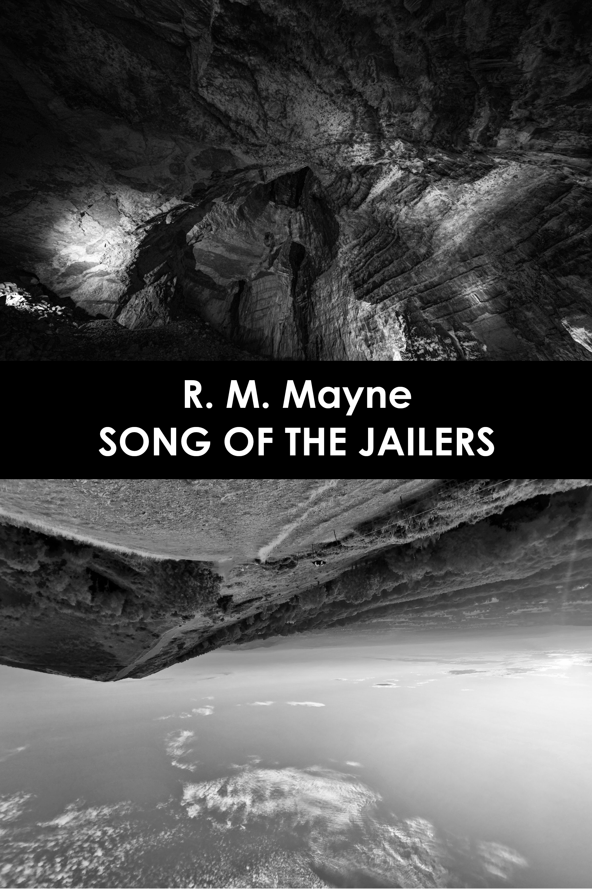

### Coming H2 2026

*I looked into her eyes and saw nothing but the serenity that had been conveyed every time I had gazed into them in the waking world. These blissful orbs watched as I drowned.*

Three people are trapped underground. A man faces a firing squad after a strange ritual destroys his island paradise. A rescue team search an abandoned research ship for its missing crew. A woman drinks herself to sleep in a remote and dilapidated medieval tower. Someone dreams of the death of a mother and child they met in a park. All these people will be unified, though they don’t know it, when they find themselves in The Ward.

[Bridge House Publishing](https://www.bridgehousepublishing.co.uk/)
 

### Under submission Q4 2026

*At the close of the dream, Caspar had gone to sleep alone, the fire within his heart dimmed by the things he'd drunk, but not fully extinguished. There was no way to find poetry in what had happened, no silver linings.*

A boy with no name dreams of a man named Caspar from the floor of his prison cell. As Caspar’s life unravels under the influence of tragedy, kidnap and the enigmatic intentions of a calculating malefactor, the boy watches on in horror, having been told by another prisoner — or perhaps, her malicious jailer — that soon, Caspar and he will perish together.  As Caspar and his wife Lauren struggle to escape their tormentors, the boy races to deliver a message that might save them both. Can he find a way to speak with the man in his dreams before it’s too late?

 